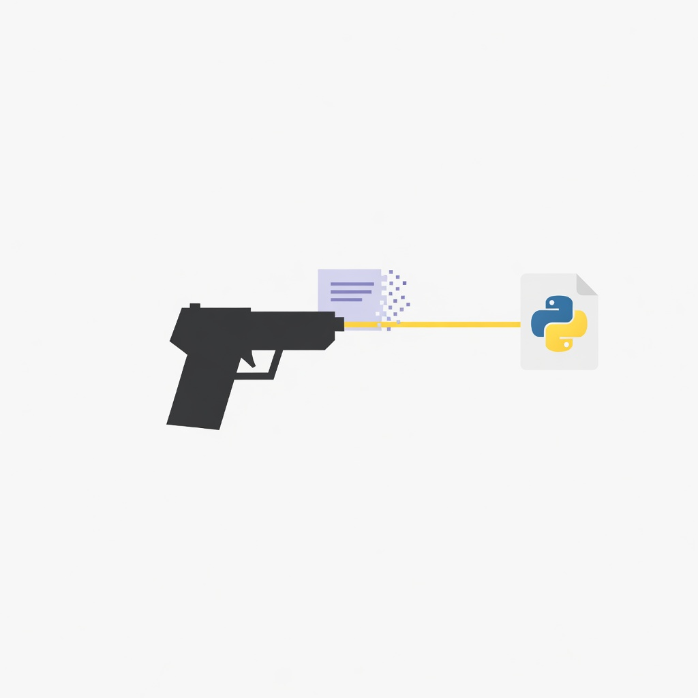

# Pytho-inator

<p align="center">
  
</p>

Skill de agente que transforma uma tarefa chata e determinística num CLI Python local e grátis. O agente roda um comando e lê a última linha. Não repensa os passos.

Este arquivo é a versão em português do [README.md](README.md). O procedimento que o agente segue está em [`skills/pytho-inator/SKILL.md`](skills/pytho-inator/SKILL.md).

## Por quê

Uma skill que dita cinco comandos de shell gasta token toda vez que o agente a lê, e ainda pode pular um passo. Um CLI que termina a tarefa gasta um comando. Se um comando resolve, a skill encolhe até esse comando.

O scanner não decide. Ele imprime uma dica curta. O agente descarta menu (`fan-out`) e o que for gosto, aprovação, voz ou estratégia (`judgment=keep`).

## No fim de uma resposta

**Claude Code.** Instale o mod na seção abaixo. Depois de um turno que gravou arquivo com Write ou Edit, ele roda o `glance` e mostra a dica debaixo da resposta. Esse texto não é outro turno do modelo. `glance` vazio fica calado. Turno abortado descarta os caminhos. Subagente fica calado; a resposta principal vê os arquivos que ele gravou.

**Qualquer outro agente** roda:

```bash
./pytho-inator glance caminho/do/arquivo.md
```

Stdout vazio é silêncio. Um hit são no máximo três linhas e a pergunta "quer que eu construa?". Não constrói no mesmo turno. Com o mod do Claude Code ligado, não rode o `glance` de novo.

Essa frase precisa estar nas instruções que o agente lê sempre (neste projeto social, o `CLAUDE.md`). A descrição da skill sozinha não dispara depois de toda resposta.

## Comandos

| Comando | O que o agente faz |
|---|---|
| `/map-automation-opportunities` | `pytho-inator map`. Onde um CLI novo substitui uma cadeia. |
| `/check-skills` | `pytho-inator check`. Onde uma skill existente encolhe até um comando. |

Os dois param antes de escrever código. Construir só começa depois de um sim, e aí segue [`skills/pytho-inator/references/gates.md`](skills/pytho-inator/references/gates.md).

## O CLI

Só stdlib. Sem chave. O `uv` roda; `python3` é o fallback.

```bash
./pytho-inator map [raiz]       # dicas ordenadas, padrão 5
./pytho-inator check [raiz]     # ponto de inserção em cada skill
./pytho-inator glance [arquivos]  # calado, a menos que um arquivo tocado esconda uma cadeia
./pytho-inator vet nome [nome]  # licença, versão e data na API JSON do PyPI
./pytho-inator self-check       # asserts offline
```

`map` e `check` olham `.claude/skills`, `.claude/commands`, `skills/` e `commands/`. Não varrem o resto da árvore. `glance` sem caminhos usa `git status` e só skill ou comando alterado. Não imprime nada sem repositório, ou sem essa mudança. Passe o caminho quando a tarefa está em outro arquivo.

`vet` imprime `ok` ou `check`. `quiet-Nd` significa que o último upload tem mais de 24 meses; licença conhecida continua `ok`. `check` é licença ausente, release yanked, ou erro do PyPI. Olhe antes de depender.

## Regras do que ele constrói

- **Ponytail ultra** no momento de escrever o CLI. Ler a skill ponytail instalada e ligar a intensidade ultra (`/ponytail ultra` no Claude Code) antes da primeira linha. Stdlib primeiro. Um arquivo. Sem framework. A escada curta em `gates.md` é só o fallback quando essa skill não está instalada.
- **uv** pro interpretador e pras dependências, no venv daquela ferramenta. Nunca o Python do sistema.
- **Grátis e open source.** MIT, Apache ou BSD quando duas bibliotecas servem igual.
- **Perguntar antes de qualquer API paga**, serviço com chave, ou conta que pode cobrar. Cota grátis com cartão conta como pago. Esperar o sim.
- **Perguntar antes de testar** o que acabou de ser escrito, inclusive o `--self-check`.
- ***Automate the Boring Stuff with Python*** (Al Sweigart, edição grátis) é o catálogo de tarefas: arquivos, texto, CSV, JSON, planilha, PDF, Word, imagem, página web, tempo, e-mail, GUI. O livro nomeia a tarefa. Não é lista de dependência, e o texto dele não é copiado aqui. O mapa está em [`gates.md`](skills/pytho-inator/references/gates.md).
- Achar biblioteca é busca web grátis mais `vet`. Não gastar um pipeline de pesquisa pago pra escolher um nome de pacote.

## Instalar

```bash
git clone https://github.com/SafeMantella/Pytho-inator.git
chmod +x Pytho-inator/pytho-inator
```

No projeto em que o agente trabalha, symlink da skill e dos dois comandos (uma cópia só):

```bash
ln -s /caminho/do/Pytho-inator/skills/pytho-inator .claude/skills/pytho-inator
ln -s /caminho/do/Pytho-inator/commands/map-automation-opportunities.md .claude/commands/
ln -s /caminho/do/Pytho-inator/commands/check-skills.md .claude/commands/
```

Abrir este repo sozinho também carrega os mesmos arquivos: `.claude/` aqui dentro aponta pra eles.

### Mod do Claude Code

A raiz do plugin é este repo. O hook chama `./pytho-inator glance`. Instalar mexe nas configurações do Claude Code do projeto, então só faça isso quando quiser o mod ligado.

A partir do clone local:

```bash
claude plugin marketplace add ./Pytho-inator --scope project
claude plugin install pytho-inator@pytho-inator --scope project
```

Com o repo no GitHub, o Claude Code 2.1.275 ou mais novo também aceita:

```
/plugin install pytho-inator --marketplace SafeMantella/Pytho-inator
```

Conferir sem instalar, de dentro do repo: `claude plugin validate . && claude plugin test .`.

## Layout

```
assets/logo.jpg       a marca
pytho-inator          wrapper (uv, depois python3)
pytho_inator.py       o scanner
hooks/register.ts     mod do Claude Code
.claude-plugin/       manifestos do plugin e do marketplace
skills/pytho-inator/  a skill do agente
commands/             /map-automation-opportunities e /check-skills
```

## Licença

MIT. Ver [LICENSE](LICENSE).
